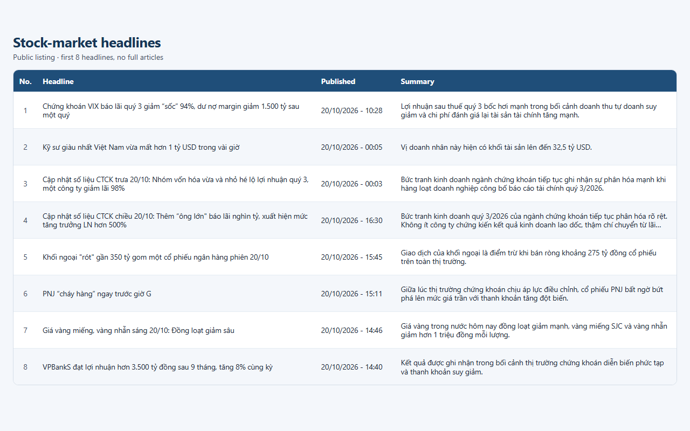

# news-scraper

Beginner project that collects **headlines** for investment monitoring.
It uses Playwright's synchronous Python API and a real Chromium browser.



The CafeF target is the stock-market section:

**https://cafef.vn/thi-truong-chung-khoan.chn**

That is the "Thị trường chứng khoán" listing behind the CHỨNG KHOÁN menu.
The scraper does not open individual articles and does not save full article text.

## Why Playwright?

`requests` downloads the raw HTML of a URL and stops there. It does not run
JavaScript, click anything, or wait for a page to finish building itself.

The practice site makes that difference obvious:

- https://quotes.toscrape.com/ (plain HTML) contains the quotes in the first download.
- https://quotes.toscrape.com/js/ starts as an empty shell. The quotes are inserted
  by JavaScript after the page loads. `requests` plus BeautifulSoup would see
  no `div.quote` elements. Playwright launches Chromium, lets that JavaScript run,
  then reads the finished page.

CafeF's first screen is in the HTML, but older headlines are added by the same
listing script the site uses when you scroll (`/timelinelist/...`). Driving a
real browser, waiting for those elements, and sending a normal browser
User-Agent matches how the page is actually built.

## Setup

From this folder, with the virtual environment already created:

```bash
.venv\Scripts\activate
pip install -r requirements.txt
playwright install chromium
```

## Usage

Quotes practice run (default 3 pages):

```bash
python scraper_quotes.py
python scraper_quotes.py --pages 2
python scraper_quotes.py --headed
```

CafeF headlines (default 30 articles):

```bash
python scraper_cafef.py
python scraper_cafef.py --max-articles 10
python scraper_cafef.py --keywords "HPG,MBS,SHB"
python scraper_cafef.py --headed
```

`--headed` shows the Chromium window. Without it, the browser stays headless.
`--keywords` keeps a headline only when the title contains one of those words
(useful for ticker codes such as HPG, MBS, and SHB).

Both scripts check `robots.txt` with `urllib.robotparser` before each URL.
A disallowed URL is skipped and the reason is written to the log.
There is a 2 second pause between pages, a 30 second timeout, and up to
3 attempts if a page does not load.

## Output columns

`sample_output/quotes_js.csv`

| Column | Meaning |
| --- | --- |
| text | Quote text |
| author | Author name |
| tags | Tags on that quote, separated by `;` |

`sample_output/cafef_news.csv` and `sample_output/cafef_news.xlsx`

| Column | Meaning |
| --- | --- |
| title | Headline |
| url | Link to the article |
| publish_time | Time shown on the listing, when the page includes one |
| summary | Short sapo from the listing, at most 300 characters |
| category | Section name, normally "Thị trường chứng khoán" |

CSV files use UTF-8 with a BOM so Excel on Windows shows Vietnamese correctly.

## Ethics

- Obey `robots.txt`. If a URL is disallowed, the script skips it.
- Save headlines, links, times, and the short sapo already shown on the listing.
  Do not copy full articles. The writing belongs to CafeF and its authors.
- Use the file for personal monitoring. Do not republish the headlines as your own feed.
- Keep the 2 second delay. Do not raise the page count just to download the archive.
- This is not investment advice. Headlines are a starting point for your own reading.
